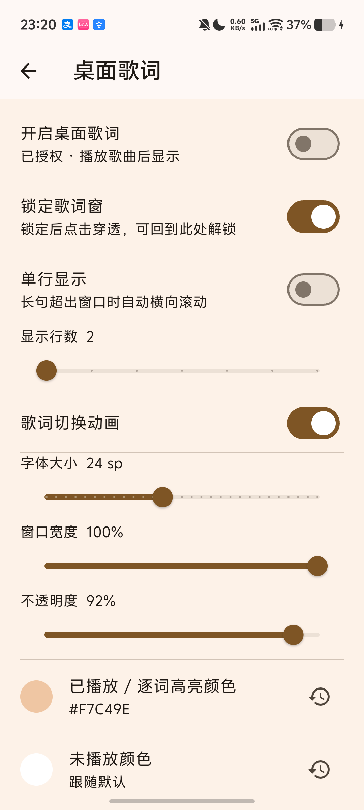

# 栖弦+

BASS 音频播放、本地音乐、自定义音源、搜索、歌单、下载、均衡器、主题与桌面歌词。

本仓库只存放发布说明、许可证、更新日志和界面截图；通过验收并获明确批准后，ARM64 APK 才会进入 GitHub Releases。修改版源码及开发历史保存在私人仓库。

<!-- RELEASE-STATUS -->
**尚未公开任何 APK。** 本地候选版本为 v1.0.10，分发许可核查尚未完成；这不是可下载的正式 Release。
<!-- /RELEASE-STATUS -->

## 下载与安装

[Releases 页面](https://github.com/krisbaialec/CyShineMusic-Releases/releases) · [最新正式版入口](https://github.com/krisbaialec/CyShineMusic-Releases/releases/latest)。尚无正式 Release 时，最新入口返回 404，不能据此判断应用已是最新版。

1. 正式发布后从上述入口下载名称带 `arm64-release.apk` 的 APK，适用于 Android 7.0 及以上 ARM64 手机。
2. 在 Android 中允许所使用的浏览器或文件管理器安装未知来源应用，再打开 APK 安装。
3. 本修改版包名为 `com.cyshine.music.dev`。只有与旧版包名、签名一致且版本号递增时才能覆盖升级保留数据；签名不同请停止，不要卸载旧版或清除数据。
4. 可用 PowerShell `Get-FileHash <APK路径> -Algorithm SHA256` 核对 Release 说明中的 SHA-256。

## 功能与修改

独立公开更新源；修复桌面歌词原文/翻译、单双行与长句滚动；优化 BASS 多次循环结束通知；独立歌词配色。

个人修改版使用独立 `.dev` 包名，可与原作者的正式版并存。版本号属于本修改版；公开更新检查只连接本仓库，不向私人仓库索取版本，也不回退到原项目更新源。

## 截图

## 来源、作者与许可

原项目 [KevinllBin/CyShineMusic](https://github.com/KevinllBin/CyShineMusic)，原作者 KevinllBin；Copyright (c) 2026 KevinllBin，MIT。

桌面歌词部分实际移植自 [kingmuchen/Mint-Music](https://github.com/kingmuchen/Mint-Music)，Copyright (c) 2026 kingmuchen，MIT。

Android 桌面歌词实现参考 [lyswhut/lx-music-mobile](https://github.com/lyswhut/lx-music-mobile)，Apache-2.0。相关修改由本修改版承担；本版本不代表原作者的官方发行。

完整主项目许可及已收集的第三方声明见 [LICENSE](LICENSE)。主项目的 MIT 许可不替代第三方组件的独立许可，也不表示原项目的代码变成专有许可。

BASS 及解码组件适用各自条款，BASS 免费使用条件限非商业用途；JAudioTagger 的准确二进制来源、LGPL 对应源码和替换/重链接材料仍待补齐。

<!-- LICENSE-REVIEW -->
分发许可核查尚未完成，当前不提供 APK。
<!-- /LICENSE-REVIEW -->

## 测试与已知问题

ARM64 Release ????????????????????????????/??/Seek/????/????????????/???????????34 ???????? 13 ??? UI ?????

当前仅在一台 ARM64 Android 手机上检查。其他设备、真实 16 KB 页设备、全部在线音源与格式组合未验证。测试日志、音源配置、歌单数据和手机信息不上传到此仓库。

公开状态以页首为准。只有验收、许可材料和维护者明确批准全部齐备后才发布；未请求发布时继续私人开发。

## 更新日志

见 [CHANGELOG.md](CHANGELOG.md)。
